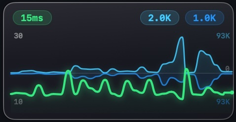
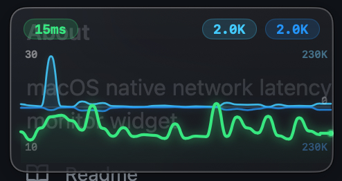

# NetMon

A minimal macOS network monitor for your menu bar or a floating desktop widget.

NetMon starts in menu bar mode by default, showing live, color-coded ping latency.
Click the latency to show or hide the regular graph widget beneath the menu bar
item, on the screen you clicked. The menu bar readout stays visible. The widget
keeps its usual resizing, graph controls, and interface icon: click the icon
for interface/IP details in a popover. Right-click the
widget for its controls or to quit. `— ms` means waiting for the first sample;
`∞ ms` means packet loss. Your mode choice is remembered across launches.

Right-click (or Control-click) the menu bar latency to **Switch to Floating
Widget** or **Quit NetMon**. To return, right-click the floating widget and
choose **Switch to Menu Bar**.
When the menu bar is already active, the widget instead offers **Remove Menu Bar**,
which keeps the widget open and switches back to floating-widget mode.

Click either traffic badge to see the five processes with the highest current
download or upload rates. The list measures one-second intervals while open;
closing it stops sampling. Rates cover non-loopback TCP/UDP traffic reported by
macOS and may differ from the interface totals in the graph.

## Features

- **Real-time ICMP ping** — pings Cloudflare (`1.1.1.1`) every 1 second using standard 56-byte packets
- **Live dual graph**:
  - latency (foreground) with segment-based color transitions
  - traffic bytes down/up (background) in mirrored blue series around a center baseline
  - smooth scrolling, interpolation and clipping at both edges
  - clean chart area (no dashed grid overlay)
  - packet loss samples drop to `0` and are highlighted in **red**
- **Dual Y-axes**:
  - left axis for latency (10-step labeling, adaptive density)
  - right axis for bytes (adaptive labels and spacing for small sizes)
- **Glass design** — semi-transparent widget with lightweight border
- **Tint/Blur presets** — 6 levels (`Very Light` ... `Very Dark` + `Off`), persisted across restarts
- **Window state persistence** — remembers size and position across restarts
- **Always on top toggle** — can be changed at runtime from context menu
- **Area-aware double-click interactions**:
  - title bar: `Minimize` / `Full`
  - graph area: `Expand (x4)` / `Restore Size`
  - right-click anywhere for context menu
- **Context menu controls**:
  - Always on Top
  - Minimize / Full
  - Expand (x4) / Restore Size
  - Reset View
  - Tint/Blur
  - Show/Hide Latency Graph
  - Show/Hide Traffic Graph
- **Keyboard shortcuts**:
  - `Cmd+E` Expand / Restore Size
  - `Cmd+M` Minimize / Full
  - `Cmd+R` Reset View
- **Loss badge behavior**:
  - Latency box shows red `∞` during packet loss
- No Dock icon; choose a compact menu bar readout or the floating widget

## Screenshots

<p>
  
</p>
<p><em>Expanded widget with dual-series network graph, axis labels, and compact metric badges.</em></p>

<p>
  
</p>
<p><em>Regular-size widget in transparent mode, showing latency foreground and mirrored bytes traffic series.</em></p>

<p>
  
</p>
<p><em>Minimized mode (title bar only) with live latency and traffic badges.</em></p>

## Requirements

- macOS 14 (Sonoma) or later
- Xcode Command Line Tools (`xcode-select --install`)

## Build & Run

```bash
git clone https://github.com/magnuslenngren/netmon
cd netmon
swift build
mkdir -p NetMon.app/Contents/MacOS
cp .build/debug/NetMon NetMon.app/Contents/MacOS/NetMon
ditto NetMon.app /Applications/NetMon.app
open /Applications/NetMon.app
```

If Swift Package Manager itself fails to start, a dependency-free, optimized
native build is also available:

```bash
zsh scripts/build-native.sh
ditto NetMon.app /Applications/NetMon.app
open /Applications/NetMon.app
```

This uses the Command Line Tools' selected SDK and ad-hoc signs the app for
local use. Set `SDKROOT` to override the SDK path if needed. It does not repair
a mismatched Command Line Tools installation.

Run the graph history regression checks with `zsh scripts/test-history.sh`.
These verify left-edge interpolation and bounded history across sample rates,
timing jitter, packet loss, and long gaps without network access.

## Install From Release (No Xcode Needed)

1. Download the latest `.dmg` from [GitHub Releases](https://github.com/magnuslenngren/netmon/releases).
2. Open the `.dmg`.
3. Drag `NetMon.app` to `Applications`.
4. Launch from `Applications`.

If macOS shows an unidentified developer warning, use **Right-click -> Open** the first time.

## Fast Run Script

Use the included script to rebuild, install to `/Applications`, and relaunch:

```bash
./run-netmon.sh
```

## Build DMG (Maintainers)

Create a versioned DMG artifact:

```bash
./scripts/build-dmg.sh 1.0.0
```

If no version is provided, it uses `YYYY.MM.DD-<short-sha>`.

## Publish GitHub Release (Maintainers)

Example:

```bash
VERSION=1.0.0
DMG_PATH="$(./scripts/build-dmg.sh "$VERSION")"
gh release create "v$VERSION" "$DMG_PATH" \
  --title "NetMon v$VERSION" \
  --notes "macOS app DMG build"
```

## Auto-launch at Login

Drag `NetMon.app` to **System Settings → General → Login Items**.
